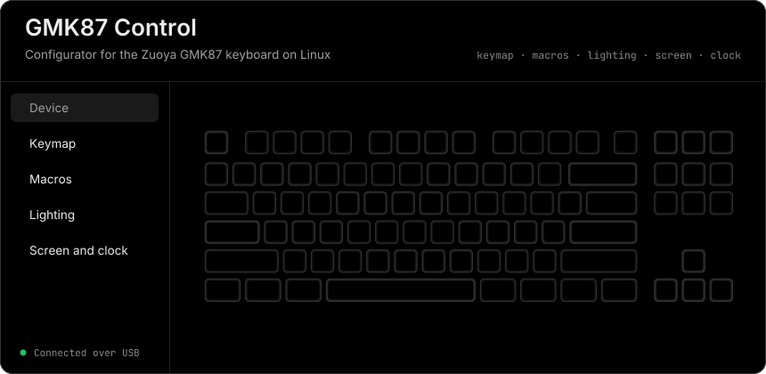
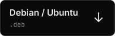

<div align="center">

<a href="https://github.com/NickiCat/gmk87app/releases/latest"></a>

**English** · [Русский](README.ru.md)

</div>

**GMK87 Control** configures the Zuoya GMK87 keyboard on Linux: keymap, macros, lighting, the screen and the clock. It is free and open source, and it never touches the firmware.

> Unofficial project, not affiliated with or endorsed by Zuoya. The app's interface is in Russian for now.

## Download

<a href="https://github.com/NickiCat/gmk87app/releases/download/v0.1.0/gmk87-control-0.1.0-1-x86_64.pkg.tar.zst"></a>
<a href="https://github.com/NickiCat/gmk87app/releases/download/v0.1.0/gmk87-control_0.1.0_amd64.deb"></a>
<a href="https://github.com/NickiCat/gmk87app/releases/download/v0.1.0/gmk87-control-0.1.0.x86_64.rpm"></a>

Version 0.1.0, x86-64 · [all releases](https://github.com/NickiCat/gmk87app/releases) · [SHA-256 checksums](https://github.com/NickiCat/gmk87app/releases/download/v0.1.0/SHA256SUMS)

<details>
<summary><b>Install</b></summary>
<br>

```sh
# Arch
sudo pacman -U ./gmk87-control-0.1.0-1-x86_64.pkg.tar.zst

# Debian, Ubuntu
sudo apt install ./gmk87-control_0.1.0_amd64.deb

# Fedora
sudo dnf install ./gmk87-control-0.1.0.x86_64.rpm
```

The packages install a udev rule, so the app works without sudo. Replug the keyboard if it isn't found right away.

</details>

## What it does

Open any row.

<details>
<summary><b>Keymap</b></summary>
<br>

Four VIA layers on a picture of the keyboard, keycode search, writing key by key with a read-back check, and a JSON backup you can restore.

</details>

<details>
<summary><b>Macros</b></summary>
<br>

Up to 16 VIA macros: text, key presses, holding and releasing keys, delays. Record them right from the keyboard, then assign one to a key with the `Macro N` code on the keymap page.

</details>

<details>
<summary><b>Lighting</b></summary>
<br>

Effect, brightness, speed, direction, rainbow and RGB color; the logo's mode, color and brightness; Win Lock.

</details>

<details>
<summary><b>Screen and clock</b></summary>
<br>

Two slots for PNG, JPG, GIF, WebP and BMP, up to 36 frames across both, with fill, fit and stretch modes and a frame delay. Choose what to show: the clock, slot 1 or slot 2. The clock syncs with the system time.

</details>

<details>
<summary><b>Log and console</b></summary>
<br>

`help`, `status`, `probe`, `config`, `sync-time`, `screen 0|1|2` and raw `via …` / `vendor …` commands.

</details>

## Cable or 2.4G

| | Cable (`320f:5055`) | 2.4G dongle (`320f:5088`) |
|---|---|---|
| Keymap (VIA) | ✅ | ✅ |
| Effect, brightness, lighting speed (VIA, firmware V0112) | ✅ | ✅ |
| Color, rainbow, direction, logo, Win Lock, screen, clock (`0xFF1C`) | ✅ | — |

The dongle doesn't pass the 64-byte vendor protocol on to the keyboard: it answers with silence or an all-zero settings block. So these features are locked in dongle mode. Settings have an experimental switch, but the app still won't write a zero block.

## Safety

- The keyboard is found through sysfs, with no packets sent to it. Talking to it starts only when you press the button.
- Only hidraw is used: the kernel driver stays attached and the keyboard keeps typing.
- Writing settings always starts by reading the current block: only the needed fields change, unknown bytes stay as they were.
- The app asks for confirmation before replacing the Fn/MO key on layer 0 and before uploading images, which overwrites both slots.
- Firmware updates aren't supported: only the version is read from the OTA interface.

Logo mode names, and which effects use the chosen color, aren't fully verified on the keyboard yet.

## Build from source

```sh
npm install
npm run dev        # run with hot reload
npm test           # protocol tests, no hardware needed
npm run typecheck
./build-docker.sh  # .deb, .pkg.tar.zst and .rpm in dist/
```

Without a package, install the udev rule by hand:

```sh
sudo install -Dm644 resources/50-gmk87.rules /usr/lib/udev/rules.d/50-gmk87.rules
sudo udevadm control --reload-rules && sudo udevadm trigger
```

## Protocol

The protocol comes from open reverse-engineering projects:

- [SrilalS/GMK87Control](https://github.com/SrilalS/GMK87Control) (MIT): VIA, the V0104/V0112 settings block, keycodes, layout.
- [codedgar/gmk87-node](https://github.com/codedgar/gmk87-node) (MIT): image upload, lighting.
- A Python script by Jochen Eisinger (BSD): the `0xFF1C` packet format, RGB565, the clock.
- [ikkentim/gmk87-usb-reverse](https://github.com/ikkentim/gmk87-usb-reverse): the original USB protocol analysis.

## License

[MIT](LICENSE).
