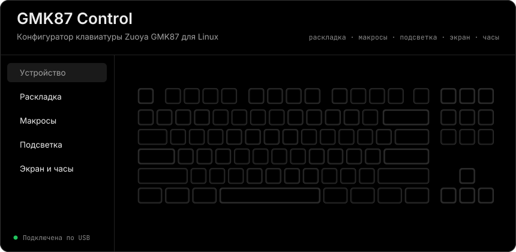
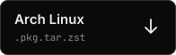
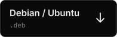
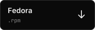

<div align="center">

<a href="https://github.com/NickiCat/gmk87app/releases/latest"></a>

[English](README.md) · **Русский**

</div>

**GMK87 Control** настраивает клавиатуру Zuoya GMK87 на Linux: раскладку, макросы, подсветку, экран и часы. Приложение бесплатное, с открытым кодом и никогда не трогает прошивку.

> Неофициальный проект, не связан с Zuoya и не одобрен ею.

## Скачать

<a href="https://github.com/NickiCat/gmk87app/releases/download/v0.1.0/gmk87-control-0.1.0-1-x86_64.pkg.tar.zst"></a>
<a href="https://github.com/NickiCat/gmk87app/releases/download/v0.1.0/gmk87-control_0.1.0_amd64.deb"></a>
<a href="https://github.com/NickiCat/gmk87app/releases/download/v0.1.0/gmk87-control-0.1.0.x86_64.rpm"></a>

Версия 0.1.0, x86-64 · [все релизы](https://github.com/NickiCat/gmk87app/releases) · [контрольные суммы SHA-256](https://github.com/NickiCat/gmk87app/releases/download/v0.1.0/SHA256SUMS)

<details>
<summary><b>Установка</b></summary>
<br>

```sh
# Arch
sudo pacman -U ./gmk87-control-0.1.0-1-x86_64.pkg.tar.zst

# Debian, Ubuntu
sudo apt install ./gmk87-control_0.1.0_amd64.deb

# Fedora
sudo dnf install ./gmk87-control-0.1.0.x86_64.rpm
```

Пакеты ставят udev-правило, поэтому sudo для работы не нужен. Если клавиатура не нашлась сразу, переподключи её.

</details>

## Что умеет

Раскрой любую строку.

<details>
<summary><b>Раскладка</b></summary>
<br>

4 слоя по VIA на схеме клавиатуры, поиск кодов, запись по одной клавише с проверкой обратным чтением, резервная копия в JSON и её восстановление.

</details>

<details>
<summary><b>Макросы</b></summary>
<br>

До 16 макросов по VIA: текст, нажатия, зажатие и отпускание клавиш, паузы. Запись прямо с клавиатуры, а назначается макрос кодом `Macro N` на странице раскладки.

</details>

<details>
<summary><b>Подсветка</b></summary>
<br>

Эффект, яркость, скорость, направление, радуга и RGB-цвет; режим, цвет и яркость логотипа; Win Lock.

</details>

<details>
<summary><b>Экран и часы</b></summary>
<br>

Два слота под PNG, JPG, GIF, WebP и BMP, до 36 кадров на оба, режимы «заполнить», «вписать» и «растянуть», задержка кадра. Можно выбрать, что показывать: часы, слот 1 или слот 2. Часы синхронизируются с системным временем.

</details>

<details>
<summary><b>Лог и консоль</b></summary>
<br>

`help`, `status`, `probe`, `config`, `sync-time`, `screen 0|1|2` и сырые команды `via …` / `vendor …`.

</details>

## Кабель или 2.4G

| | Кабель (`320f:5055`) | 2.4G-донгл (`320f:5088`) |
|---|---|---|
| Раскладка (VIA) | ✅ | ✅ |
| Эффект, яркость, скорость подсветки (VIA, прошивка V0112) | ✅ | ✅ |
| Цвет, радуга, направление, логотип, Win Lock, экран, часы (`0xFF1C`) | ✅ | — |

Донгл не передаёт клавиатуре 64-байтный вендорский протокол: в ответ либо тишина, либо нулевой блок настроек. Поэтому в режиме донгла эти функции заблокированы. В настройках есть экспериментальный переключатель, но нулевой блок приложение всё равно не запишет.

## Безопасность

- Поиск клавиатуры идёт через sysfs, без пакетов на устройство. Обмен с клавиатурой начинается только по кнопке.
- Используется только hidraw: драйвер ядра не отключается, клавиатура продолжает печатать.
- Запись настроек всегда начинается с чтения текущего блока: меняются только нужные поля, неизвестные байты остаются как были.
- Перед заменой клавиши Fn/MO на слое 0 и перед загрузкой изображений (она перезаписывает оба слота) приложение просит подтверждения.
- Обновление прошивки не поддерживается: из OTA-интерфейса читается только версия.

Названия режимов логотипа и то, какие эффекты используют выбранный цвет, на клавиатуре проверены не полностью.

## Сборка из исходников

```sh
npm install
npm run dev        # запуск с hot reload
npm test           # тесты протокола, клавиатура не нужна
npm run typecheck
./build-docker.sh  # .deb, .pkg.tar.zst и .rpm в dist/
```

Без пакета udev-правило ставится вручную:

```sh
sudo install -Dm644 resources/50-gmk87.rules /usr/lib/udev/rules.d/50-gmk87.rules
sudo udevadm control --reload-rules && sudo udevadm trigger
```

## Протокол

Протокол взят из открытых реверс-инжиниринговых проектов:

- [SrilalS/GMK87Control](https://github.com/SrilalS/GMK87Control) (MIT): VIA, блок настроек V0104/V0112, коды клавиш, раскладка.
- [codedgar/gmk87-node](https://github.com/codedgar/gmk87-node) (MIT): загрузка изображений, подсветка.
- Python-скрипт Jochen Eisinger (BSD): формат пакетов `0xFF1C`, RGB565, часы.
- [ikkentim/gmk87-usb-reverse](https://github.com/ikkentim/gmk87-usb-reverse): исходный разбор USB-протокола.

## Лицензия

[MIT](LICENSE).
